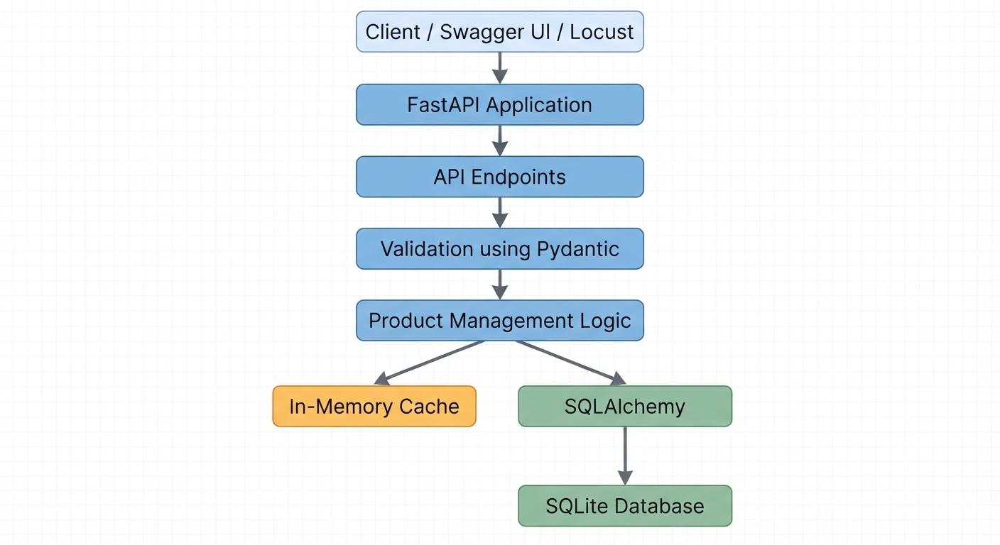
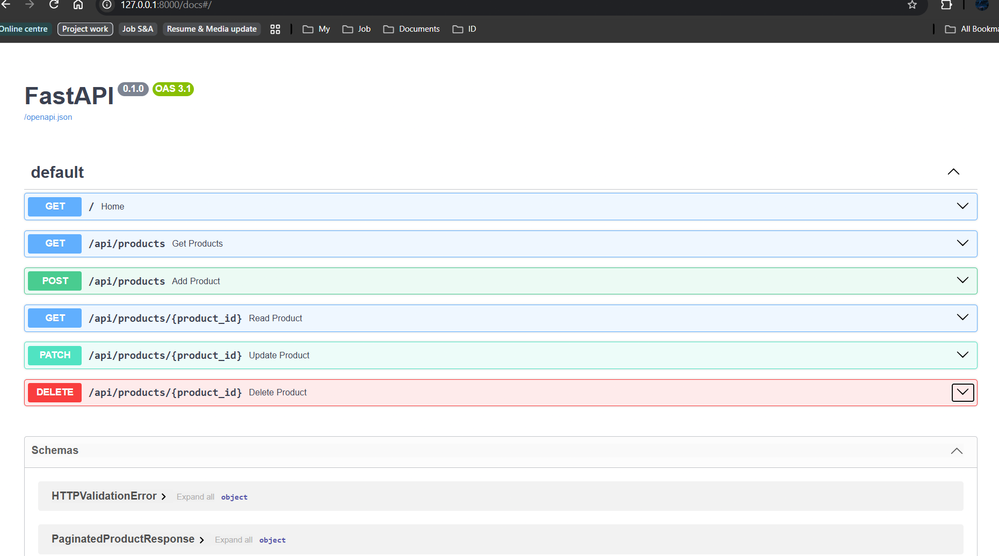
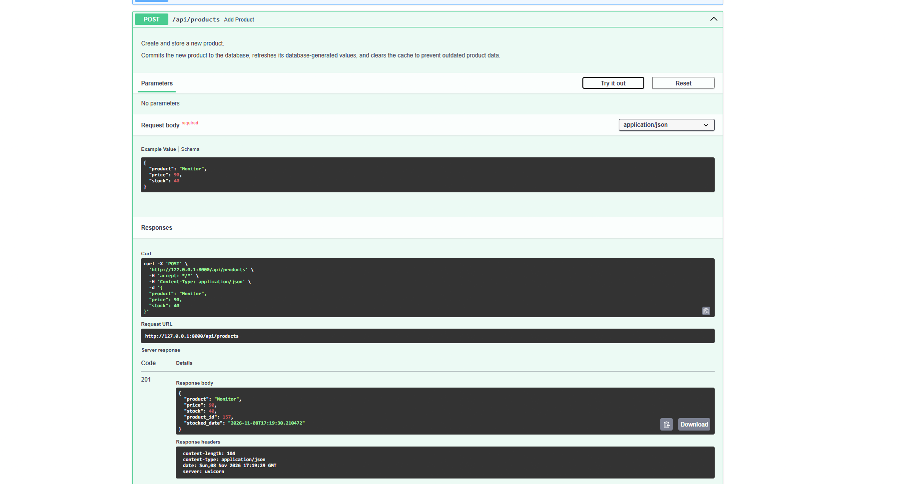
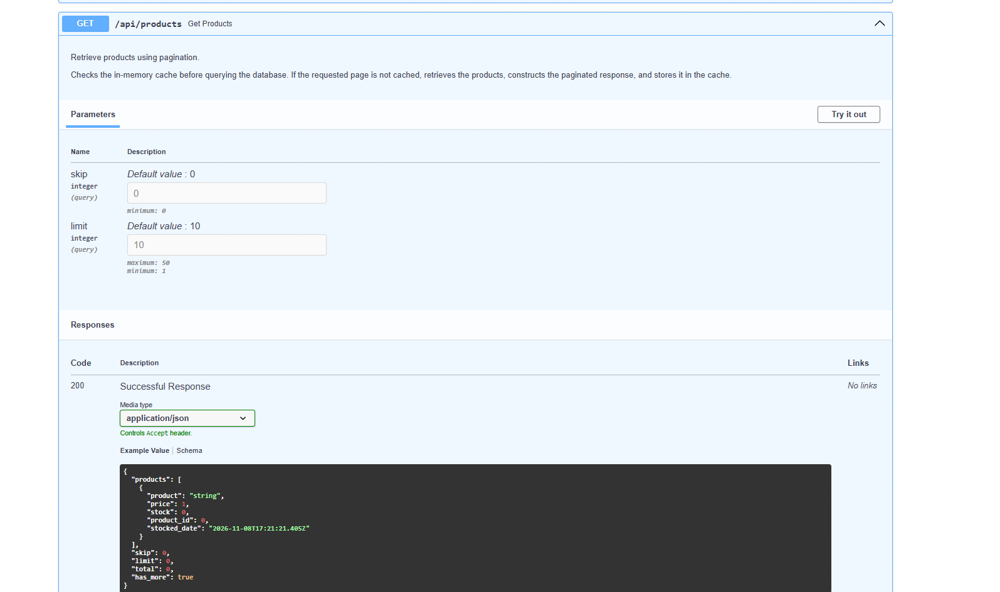
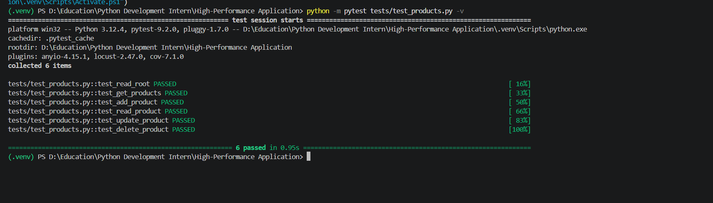
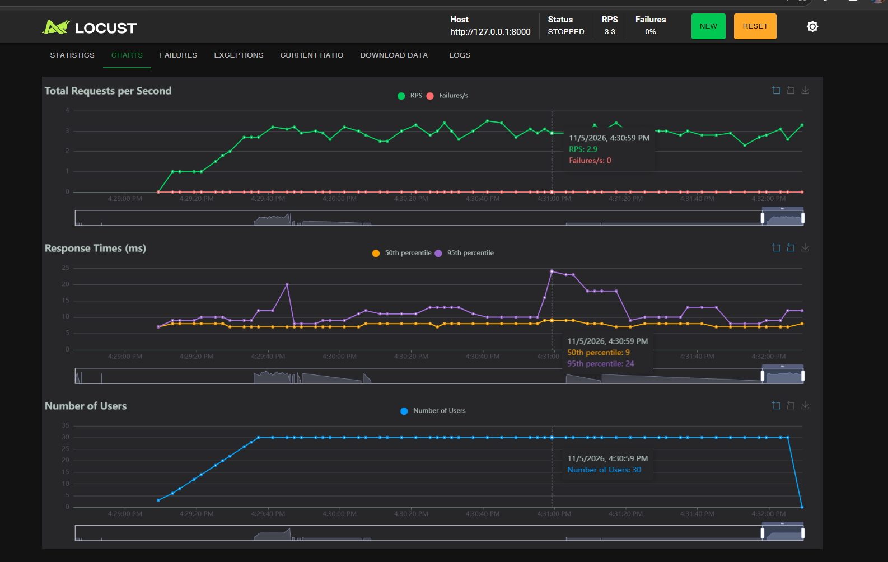
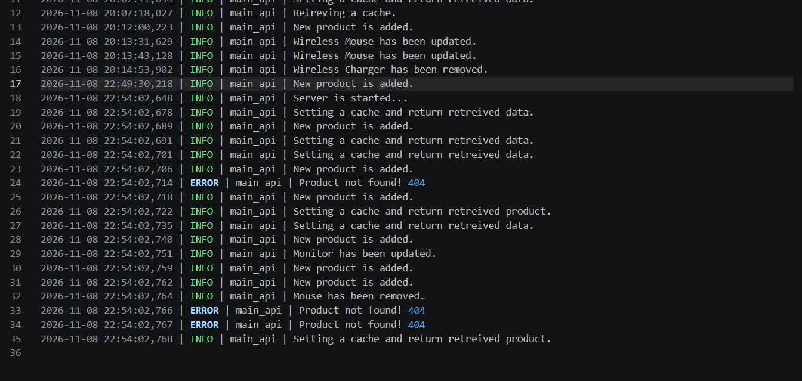

# High-Performance Application with Advanced Architecture

A Python-based product management REST API developed using FastAPI, SQLAlchemy, and SQLite, focusing on application performance, database optimization, in-memory caching, automated testing, and load testing.

## 📑 Table of Contents

1. [Project Overview](#project-overview)
2. [Project Objectives](#project-objectives)
3. [Key Features](#key-features)
4. [Technology Stack](#technology-stack)
5. [System Architecture](#system-architecture)
6. [Project Structure](#project-structure)
7. [Performance Optimization](#performance-optimization)
8. [API Endpoints](#api-endpoints)
9. [Performance Benchmark](#performance-benchmark)
10. [Screenshots](#screenshots)
11. [Installation and Setup](#installation-and-setup)
12. [Running Tests](#running-tests)
13. [Running Load Tests](#running-load-tests)
14. [Monitoring and Logging](#monitoring-and-logging)
15. [Limitations and Future Improvements](#limitations-and-future-improvements)
16. [Technical Documentation](#technical-documentation)
17. [Conclusion](#conclusion)
18. [Developer](#developer)

## Project Overview

The **High-Performance Application with Advanced Architecture** explores techniques used to improve the efficiency and reliability of web applications.

The application provides product management functionality through RESTful API endpoints. It incorporates pagination, in-memory caching, database query optimization, and structured logging to improve request handling and application maintainability.

Performance is evaluated using Locust, while Pytest is used to verify API functionality, input validation, and caching operations.

**Project Specialization:** High-Traffic Web Service

## Project Objectives

- Develop a RESTful API using FastAPI.
- Implement database operations using SQLAlchemy and SQLite.
- Improve data retrieval efficiency through pagination.
- Reduce repeated database queries using in-memory caching.
- Implement thread-safe cache operations.
- Validate API requests using Pydantic.
- Perform automated testing and code coverage analysis.
- Evaluate application performance using load testing.
- Implement structured application logging.

## Key Features

- **RESTful API:** Product creation, retrieval, updating, and deletion using FastAPI.
- **Database Management:** SQLite database integration through SQLAlchemy ORM.
- **Pagination:** Controlled product retrieval using `skip` and `limit` parameters.
- **In-Memory Caching:** TTL-based caching using `cachetools.TTLCache`.
- **Thread-Safe Cache:** Cache operations protected using Python's `threading.Lock`.
- **Cache Invalidation:** Cached data is cleared after product creation, updates, and deletion.
- **Data Validation:** Request and response validation using Pydantic.
- **Application Logging:** Module-specific log files using Python's logging module.
- **Automated Testing:** API and cache functionality tested using Pytest.
- **Performance Testing:** Concurrent user simulation and response-time measurements using Locust.

## Technology Stack

| Category | Technology |
|---|---|
| Programming Language | Python 3.12 |
| API Framework | FastAPI |
| ASGI Server | Uvicorn |
| Database | SQLite |
| ORM | SQLAlchemy |
| Data Validation | Pydantic |
| Caching | cachetools |
| Synchronization | threading.Lock |
| Testing | Pytest |
| Test Client | HTTPX |
| Coverage | pytest-cov |
| Load Testing | Locust |
| Profiling | cProfile |
| Logging | Python logging |

## System Architecture

The application follows a modular architecture that separates API handling, data validation, product management, caching, database operations, and logging.



### Architecture Components

1. **Client Layer:** Swagger UI and Locust interact with the application through HTTP requests.
2. **FastAPI Application:** Receives requests and routes them to the appropriate API endpoints.
3. **Validation Layer:** Pydantic validates incoming data and structures API responses.
4. **Product Management Logic:** Handles product creation, retrieval, updating, and deletion.
5. **Caching Layer:** Stores frequently requested product information temporarily.
6. **Database Layer:** SQLAlchemy manages database operations and communicates with SQLite.

## Project Structure

```text
High-Performance Application/
│
├── configs/
│   ├── __init__.py
│   └── general_logger.py
│
├── data/
│   └── products.db
│
├── docs/
│   └── screenshots/
│       ├── architecture_diagram.png
│       ├── application_logs.png
│       ├── locust_performance.png
│       ├── pagination.png
│       ├── product_creation.png
│       ├── pytest_results.png
│       └── swagger_ui.png
│
├── logs/
│   ├── main_api.log
│   └── memory_cache.log
│
├── tests/
│   ├── test_cache.py
│   └── test_products.py
│
├── cache.py
├── config.py
├── database.py
├── locustfile.py
├── main.py
├── models.py
├── requirements.txt
├── schemas.py
└── .gitignore
```

## Performance Optimization

The application implements several optimization techniques.

### 1. In-Memory Caching

The application uses `cachetools.TTLCache` with the following configuration:

| Configuration | Value |
|---|---:|
| Maximum entries | 1,000 |
| Time to live | 30 seconds |
| Synchronization | threading.Lock |

Product listings and individual product records are cached to reduce repeated database retrieval operations.

### 2. Database Pagination

The product listing endpoint supports pagination through two query parameters:

- `skip`: Number of records to skip.
- `limit`: Maximum number of records to retrieve.

The default limit is 10, with a maximum allowed limit of 50.

### 3. Efficient Database Retrieval

SQLAlchemy is used to execute structured database queries.

Individual products are retrieved using their primary key, while product listings use ordered retrieval and pagination.

### 4. Cache Invalidation

The application clears cached entries after product creation, updating, and deletion to prevent outdated product information from being returned.

## API Endpoints

| Method | Endpoint | Description |
|---|---|---|
| GET | `/` | Check application availability |
| GET | `/api/products` | Retrieve paginated products |
| POST | `/api/products` | Create a product |
| GET | `/api/products/{product_id}` | Retrieve a product by ID |
| PATCH | `/api/products/{product_id}` | Update an existing product |
| DELETE | `/api/products/{product_id}` | Delete a product |

### Interactive API Documentation

FastAPI automatically generates interactive API documentation through Swagger UI.

After starting the application, access:

`http://127.0.0.1:8000/docs`

## Performance Benchmark

The application was evaluated using Locust with 30 simulated users.

### Recorded Results

| Performance Metric | Result |
|---|---:|
| Simulated Users | 30 |
| Total Requests | 509 |
| Failed Requests | 0 |
| Average Response Time | 8.09 ms |
| Median Response Time | 8 ms |
| 95th Percentile | 11 ms |
| 99th Percentile | 20 ms |
| Minimum Response Time | 3 ms |
| Maximum Response Time | 111 ms |
| Average Response Size | 1,176 bytes |
| Reported Current RPS | 3.3 |

The recorded test completed 509 requests without reported failures.

These results represent the observed performance under the specific test configuration and environment. They should not be interpreted as a guaranteed production capacity.

## Screenshots

### Application Architecture


### Swagger UI



### Product Creation



### Pagination



### Automated Testing



### Locust Performance



### Application Logs



## Installation and Setup

### Prerequisites

- Python 3.12 or compatible version
- pip package installer
- Git (optional)

### 1. Clone the Repository

```bash
git clone <repository-url>
```

Navigate into the project directory:

```bash
cd High-Performance-Application
```

### 2. Create a Virtual Environment

```bash
python -m venv .venv
```

### 3. Activate the Virtual Environment

Windows:

```bash
.venv\Scripts\activate
```

### 4. Install Dependencies

```bash
python -m pip install -r requirements.txt
```

### 5. Run the Application

```bash
uvicorn main:app --reload
```

The application will be available at:

`http://127.0.0.1:8000`

Interactive API documentation:

`http://127.0.0.1:8000/docs`

## Running Tests

Execute the automated test suite:

```bash
python -m pytest -v
```

Generate a test coverage report:

```bash
python -m pytest --cov=. --cov-report=term-missing
```

## Running Load Tests

Start the application first.

Open another terminal and execute:

```bash
locust -f locustfile.py --host http://127.0.0.1:8000
```

Locust provides an interface for configuring simulated users and observing application performance.

## Monitoring and Logging

The application uses Python's built-in logging module to record application events.

Two module-specific log files are configured:

- `logs/main_api.log` – API application events.
- `logs/memory_cache.log` – Cache-related events.

Locust provides request statistics, including response times, throughput, and failure counts.

## Limitations and Future Improvements

The current implementation focuses on a lightweight product management API and practical performance optimization techniques.

Potential future improvements include:

- Migration from SQLite to PostgreSQL for larger database workloads.
- Distributed caching using Redis.
- Asynchronous database operations.
- Additional database indexes based on query analysis.
- Containerization using Docker.
- Application orchestration using Kubernetes.
- Centralized monitoring using Prometheus and Grafana.
- Expanded performance testing under larger workloads.

These are potential extensions and are not part of the current implementation.

## Technical Documentation

Refer to the project's main technical documentation for detailed explanations of:

- System architecture.
- Database design and optimization.
- Caching implementation.
- API functionality.
- Concurrency and performance management.
- Testing and quality assurance.
- Benchmark evaluation.
- Scalability considerations.

## Conclusion

This project demonstrates the development of a product management API with an emphasis on performance optimization, database efficiency, caching, automated testing, and load testing.

It provides practical experience in designing modular web applications and evaluating their performance through measurable testing techniques.

The implementation serves as a foundation for further exploration of scalable web service architectures and advanced application optimization.

## Developer

**Antony John Robees A**

Python Developer | Backend Developer | Computer Science Graduate

**GitHub:** [AJRobees](https://github.com/AJRobees)

---

**Project:** High-Performance Application with Advanced Architecture  
**Specialization:** High-Traffic Web Service  
**Programming Language:** Python 3.12